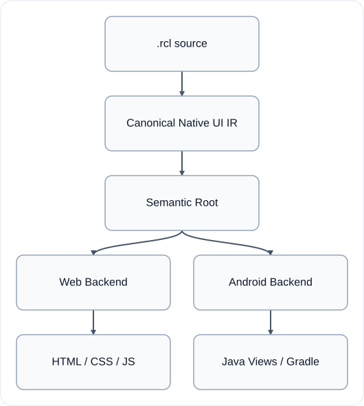
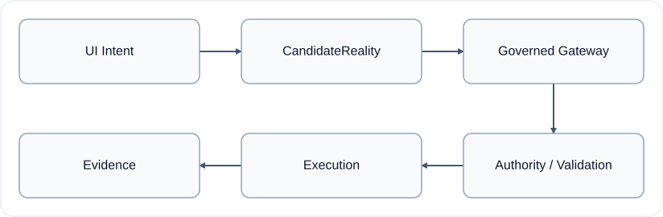
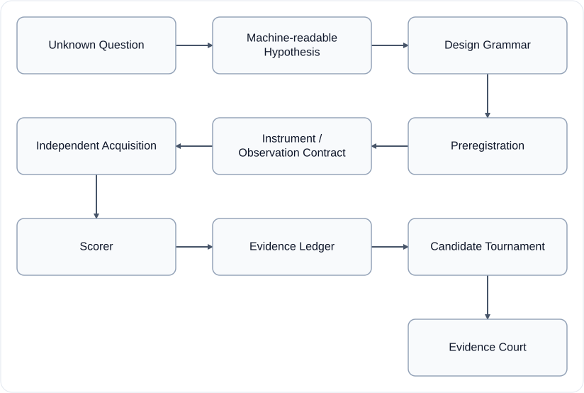
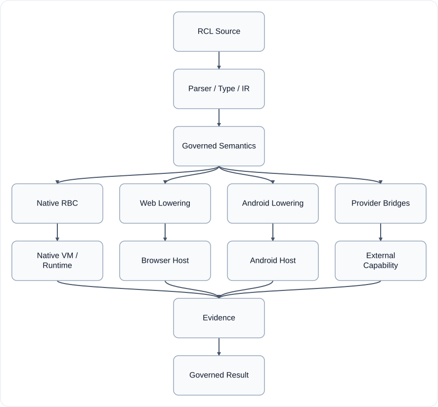

<div align="center">

# RCL — Reality Compiler Language

**RESEARCH_PREVIEW · K400 367/400 (91.75%) · INCOMPLETE · U3**

**A programming language that makes permissions, state changes, and evidence part of the program.**

[English](README.md) · [简体中文](README.zh-CN.md) · [5-minute Quick Start](GETTING_STARTED.md) · [Website / Playground](https://rcl-rncs-mcp.vercel.app) · [Current Status](CURRENT-STATUS.md)

[](LICENSE)
[](package.json)
[](CURRENT-STATUS.md)
[](CURRENT-STATUS.md)

</div>

RCL (Reality Compiler Language) is an open-source language for writing programs whose state changes must obey explicit rules: **who can act, what may change, which conditions must hold, and what evidence records the result**.

This repository contains the language implementation, an RCL-authored native-core compiler, a native bytecode VM, Web/Android backends, and a verification toolchain. Canonical source: `xingxuling/RCL@main`.

**RCL is a research preview. K400 currently records 367/400 PASS and 33 UNTESTED; its verdict is INCOMPLETE.** The previous promotion to a 2.0 release overstated whole-language maturity. Build identity: `2.0.0` is retained for existing package/native artifacts and historical receipts; further version advancement is frozen. The verified session/compiler profiles remain useful bounded implementation evidence. See the [maturity policy](docs/governance/RCL_RESEARCH_MATURITY_POLICY.md) and [K400 campaign](docs/K400_COMPLETION_CAMPAIGN_v0.1.md).

The [RCL-owned kernels](docs/K400_NEW_FAMILIES_2026-10-13.md) implement token-expression compilation, RGB transforms and run-length round trips, and fixed-step platform-game rules. All three pass twelve actual execution contexts with frozen inputs and unchanged independent repairs. Their bounded scopes keep the remaining 33 K400 cells open.

The [browser-native campaign](docs/K400_BROWSER_NATIVE_2026-10-13.md) now compiles and executes RCL inside an actual Chromium window, including exact compiler-byte parity, native rejection diagnostics and page reset. It adds fourteen unique coordinates, reaching 216. The active goal is the complete 400-cell campaign.

The [GPU-native campaign](docs/K400_GPU_NATIVE_2026-10-13.md) adds fifteen distinct cells, reaching 231. A generic RBC interpreter executes recursion, sequence operations, scoped authority and transactions on actual AMD FP64 OpenCL hardware; compilation and hashing of returned snapshots remain host-owned. All frozen inputs, independent repairs and process-reset controls pass.

The [RNCS candidate-runtime campaign](docs/K400_RNCS_CANDIDATE_2026-10-13.md) adds fifteen further coordinates, reaching 246. The canonical RNCS branch executor actually invokes RCL, verifies its source-owned admission, merges a local candidate and rejects stale or unapproved merges. Typed binary64 transport preserves numeric values. These are local candidate-runtime profiles with deliberate host execution credit.

The [replicated-counter campaign](docs/K400_REPLICATED_COUNTER_2026-10-13.md) adds fifteen distributed-program coordinates, reaching 261. RCL owns component-wise replicated-state merge and packet admission. Forty-five real HTTP nodes across fifteen execution contexts verify partition/recovery, stale/duplicate delivery and denied requests, alongside frozen inputs and independent repairs.

The [soft realtime campaign](docs/K400_SOFT_REALTIME_2026-10-13.md) adds sixteen unique coordinates, reaching 277. Thirteen frozen programs use actual monotonic timers and asynchronous native processes, with RCL-owned deadline publication and failure settlement. Real timeout/cancellation exits, backpressure, pause/resume and recovery pass; hard realtime timing is outside this local profile.

The [native game campaign](docs/K400_NATIVE_GAME_2026-10-13.md) adds fifteen unique coordinates, reaching 292; K188 keeps an additional profile without duplicate credit. General RCL hooks actually run on every fixed step, and a native RCL scene controller owns input, motion, gravity, collisions and authority. All thirteen profiles pass exact scene replay and real process reset; distributed hooks also pass the existing three-node HTTP packet controls.

The [scientific workbench campaign](docs/K400_SCIENTIFIC_2026-10-13.md) adds sixteen unique coordinates, reaching 308. RCL owns native shifted moments/regression and error-bound publication; actual NumPy/SciPy observes the same exact binary64 measurements independently. Fourteen profiles pass sealed inputs, unchanged repairs, numeric-mutant rejection, controller recovery and real observer exits; the new statistics profile adds evidence without duplicate coordinate credit.

The [native advisory AI campaign](docs/K400_ADVISORY_AI_2026-10-13.md) adds fifteen unique coordinates, reaching 323. Actual native RCL MLP training and forward execution feed a callable pinned-model workflow. Fourteen profiles verify exact input/model roots, independent numerical replay, denied model replacement and predictor authority, failure settlement and real controller reset; K233 and repeated algorithm coordinates retain additional profiles without duplicate credit.

The [target-backed Native UI campaign](docs/K400_NATIVE_UI_2026-10-13.md) adds thirty-four unique GUI/Web coordinates, reaching 357. RCL owns event mutations, derived text and render projections; actual browser clicks, authenticated/stale-root transport, reload and mobile viewport checks pass across nineteen selected RCL backends. All 380 baseline flows, 190 sealed input flows and 57 unchanged independent repairs pass. Four existing coordinates retain additional profiles. Native OS widgets, mobile-family completion and arbitrary UI semantics remain outside this integer-counter profile.

The [compiler workflow continuation](docs/K400_COMPILER_PIPELINE_2026-10-13.md) closes K328/K330/K335, reaching 360. Actual RCL-authored compilation and native execution expose separate process traces and instruction/byte metrics. Existing game/media/CRDT kernels pass 60 rounds, 30 sealed inputs, nine fresh repairs and ten extra alternative-repair cases; the distributed workflow binds actual three-node HTTP packets to compiler/VM ledgers.

The [native Android continuation](docs/K400_NATIVE_MOBILE_2026-10-14.md) provides actual native Views, touch and lifecycle recovery with RCL-owned backend state. Separate HTTP/replica/cold-handler adapters fix readiness publication, and asynchronous ADB transport keeps the RCL bridge responsive. One paired embedded flow preserves all five state roots. Previous mobile receipts are archived and all nineteen backends are reacquired against unchanged budgets; the incomplete index adds no K400 credit yet. The frozen APK and an interactive demo command are available.

The [persistent Sequence runtime candidate](docs/NATIVE_SEQUENCE_RUNTIME_2026-10-14.md) preserves twenty byte-identical full-compiler self-compilation generations, with a 3.9-second median on this Windows host. One same-source comparison measured 159.1 seconds in the original runtime and 6.4 seconds in the candidate, about 24.7× faster. This separate optional runtime does not advance the version or K400 count.

The [native-core self-hosting continuation](docs/K400_SELFHOST_COLUMNS_2026-10-14.md) closes K059/K039/K019/K079, reaching 364. A separate RCL compiler fixes non-BMP source-column identity and reproduces its complete artifact for eighty generations across Windows/Linux/WASI/Chromium. Forty sealed programs and twelve unchanged fresh-repair replays pass; the original failed Unicode contract retains zero credit.

[GPU Text and UI continuation](docs/K400_GPU_TEXT_2026-10-14.md) adds K163/K164/K165, reaching 367 distinct cells. Device-owned UTF-8 Text operations and numeric formatting now drive actual Chromium clicks and Android native touch. Separate scientific-number compilation, native oracle parity, frozen inputs, unchanged fresh repairs and tamper rejection pass. Android ATD screenshots are black, so visual pixel acceptance remains pending; native View/text/touch/lifecycle semantics are verified. The remaining 33 cells stay open.

## Why RCL?

- **Put authority next to behavior.** Subjects, warrants, guards, mutations, and invariants are language constructs. A state transition declares its permission and validation requirements instead of leaving that contract implicit in surrounding application code.
- **Make execution inspectable.** Transitions produce witnesses and evidence; the toolchain uses artifact and semantic-state roots to check results across implementations. Evidence remains tied to the profile actually tested.
- **Keep semantics across execution targets.** RCL owns the state and authority model while native bytecode, Web, and Android paths provide different execution environments. The candidate Native UI model shares an IR and semantic root across Web/Android backends.
- **Verify the compiler with itself.** The native-core compiler is written in RCL and has a recorded byte-identical `C0 == C1 == C2` fixed point. This is compiler self-hosting, not a claim that the entire runtime is self-hosted.

RCL is useful for exploring permission-aware application state, auditable automation, and language/runtime research. The current implementation extends the governed core into stateful native execution and durable local sessions. Each profile retains its bounded evidence; whole-language development is assessed through K400.

[Implementation capabilities](#version-20) · [Quick start](#quick-start) · [Persistent sessions](#4-run-a-persistent-session) · [Examples](#learn-rcl-by-example) · [Verification](#what-is-verified-today) · [Architecture](#architecture)

---

<a id="version-20"></a>

## Historical 2.0 implementation milestone

The implementation carrying build identity 2.0.0 makes a program callable across multiple inputs and process lifetimes:

- **Stateful native sessions:** initialize once, invoke a declared rule by name, and retain admitted state between calls. Reference and native implementations share the governed transaction contract.
- **Source-declared inputs:** `input` facets accept typed Number, Truth or Text observations. Rules own other state changes, and conditional warrants are checked against current state for each invocation.
- **Atomic proposals:** guards, authority and preserves decide whether a transition commits. Rejected commands, false guards and `foresee` projections retain the prior committed state and inputs.
- **Durable local replay:** bind the source, bytecode, commands and exact state roots in a journal. A new native process replays and verifies the committed prefix; request IDs prevent duplicate retries and expected revisions reject stale updates.
- **RCL-authored session compilation:** the native session compiler is written in RCL and its target bytecode is checked against the bootstrap compiler. Session operations use RBC 1.3; state-root v2 and existing typed-reference ABI identities remain independent.

In the original 2.0 counter comparison, 50 calls through the v1.0 daemon's default `RUN` profile each finish at **1**; 50 v2.0 session calls retain state and finish at **50**. Warm native API invocation p95 was about **3 ms**, including IPC and independent root verification, for that source snapshot. This historical measurement excludes durable journal writes and is not a fresh benchmark of later maintenance. See the [verification record](docs/v2.0/verification.json) and [session acceptance](docs/v2.0/acceptance.md).

The durable profile covers local cooperative writers and pure RCL rules. Journals are bounded to 64 MiB / 10,000 accepted commands. Provider effects, distributed exactly-once execution and hardware power-loss recovery are outside that profile. Full details and caller-authentication responsibilities are in the [session contract](docs/v2.0/session-contract.md).

**2026-10-12 maintenance, still 2.0.0:** invalid native evidence now closes the session and its durable writer; queued requests capture the caller's original values; the CLI exposes trusted history pins and rejects invalid flags; repeated alterations produce matching native/reference receipts. [The maintenance record](docs/maintenance/session-integrity-2026-10-12.md) binds **61 passing focused checks**, including 37 session checks, to the updated source. No GitHub Actions were run.

**Compiler admission maintenance:** the RCL-authored compiler now rejects invalid conditional-warrant references, operators, argument types and reachable predicate return types before emitting bytecode. [The compiler record](docs/maintenance/warrant-compiler-admission-2026-10-12.md) binds **89 passing focused checks**, 120 eligible examples with exact byte parity and a newly verified native `C0 == C1 == C2` fixed point. Package/native versions remain 2.0.0; earlier maintenance records retain their tested source snapshots.

### Stable core inherited from 1.0

The native VM and `rcl run` default to `rcl.semantic-state-root.v2`, using exact finite binary64 encoding for final states and transaction roots. Historical native v1 receipts remain verifiable through explicit algorithm selection. The `runReality` reference API preserves its distinct `rcl.reference-state-root.v0.6` default; pass `stateRootAlgorithm` for cross-runtime v2 execution. See the [stable contracts](docs/v1.0/language-contract.md), [root protocol](docs/v1.0/semantic-state-root-v2.md) and [release acceptance](docs/v1.0/acceptance.md).

## Portable native execution

The [native-core genome campaign](docs/K400_GENOME_CAMPAIGN_2026-10-13.md) also verifies bounded learning, agent deliberation, workflow, logical events, governance/reactive and mixed-paradigm programs on all four targets. Each has ten pre-sealed cases and three independently repaired-source replays. The `createPortableHttpTarget` API provides authenticated loopback compilation/execution; its [completed execution-context campaign](docs/K400_EXECUTION_CONTEXTS_2026-10-13.md) also verifies persistent embedded instances and two-worker recovery.

The same native C VM now runs as a Windows executable, wasm32-WASI module, Linux executable and x86_64 Android emulator native process. Linux/Android compile source on their actual target with the RCL-authored compiler RBC; WASI uses that compiler on the Windows host. The current profiles cover algorithms/CLI, in-memory relational transactions and discrete simulation/scientific calculations. They have identical RBC bytes and semantic roots across credited targets.

```sh
rcl portable-run wasm-vm examples/universal-stress/expansion-wave1/algorithm.rcl
rcl portable-run linux examples/universal-stress/portable-profiles/relations.rcl
rcl portable-run android examples/universal-stress/portable-profiles/simulation-scientific.rcl
```

The API exports `createPortableNativeTarget(target)` with `compile`, `execute` and `dispose`. Checked runtime artifacts are included in `native/wasi/` and `native/linux/`. Linux execution on Windows requires the configured WSL distribution; Android requires the connected x86_64 emulator. See [setup and evidence](docs/K400_EXPANSION_CAMPAIGN_2026-10-13.md). These are native-core profiles; no browser, physical-device, mobile-UI or whole-language portability claim follows from them.

## Quick start

Requirements: Git, Node.js 20+, and npm. Start with the JavaScript/reference runtime from source:

### 1. Clone and install

```bash
git clone https://github.com/xingxuling/RCL.git
cd RCL
npm install
node src/reality-hub-cli.mjs --version
```

The version command prints `2.0.0`. Source examples below use the public CLI entrypoint directly, so a global `rcl` installation is optional.

### 2. Run a complete program

```bash
npm run demo
```

That command runs [`examples/hello-reality.rcl`](examples/hello-reality.rcl):

```rcl
reality FirstLight {
  facet world.greeting : Text = "unformed"

  subject founder {
    facet awareness : Number = 0
    warrant world.write on world
  }

  emergence hello {
    cause founder
    when world.greeting == "unformed"
    needs world.write on world
    alter world.greeting <- "Hello, reality."
    alter founder.awareness <- founder.awareness + 1
    preserve founder.awareness >= 0
    witness "rcl:first-light"
  }

  foresee hello
  realize hello
}
```

Read it as:

```text
initial state
+ actor
+ authority
+ precondition
+ proposed mutation
+ invariant
+ evidence
+ commit
```

The interesting part is not the greeting. It is that **who may change what, under which conditions, while preserving which invariants, is explicit in the program**.

### 3. Build and run the native path

On Unix-like systems, the native build uses `make`, a C11 compiler, and OpenSSL/libcrypto development files; see [`native/Makefile`](native/Makefile). Windows uses the separate [`build-native-windows.mjs`](scripts/build-native-windows.mjs) toolchain path. Native build prerequisites are separate from the reference quick start.

```bash
npm run build:native
npm run demo:native
```

Then try explicit bytecode compilation + native execution:

```bash
npm run demo:bytecode
```

### 4. Run a persistent session

```bash
npm run demo:session
```

The [persistent counter demo](examples/sessions/persistent-counter-demo.mjs) commits an input, projects a change, restarts the native process, retries the original request, revokes access, and verifies native/reference replay. Each default run creates its own state directory.

To inspect the individual commands from the checkout, use a new `counter-state` directory:

```bash
node src/reality-hub-cli.mjs session init examples/sessions/governed-counter.rcl ./counter-state
node src/reality-hub-cli.mjs session invoke ./counter-state examples/sessions/increment-command.json
node src/reality-hub-cli.mjs session invoke ./counter-state examples/sessions/increment-command.json
node src/reality-hub-cli.mjs session inspect ./counter-state
node src/reality-hub-cli.mjs session verify ./counter-state --reference
```

The first invocation sets the counter to `3`. The identical retry reports `replayed: true` and leaves the journal at revision `1`. For a new command, choose a new `requestId` and the current `expectedRevision`; see the [command example](examples/sessions/increment-command.json).

Session commands require the native daemon and compiler. The verified Windows source includes prebuilt tools bound to their source bytes; rebuild changed native sources with `npm run build:native`. Unix builds use the prerequisites described above; fresh 2.0 Linux execution has not been verified.

### 5. Continue learning

For the rest of the runnable path — Web state, Native UI, Android, bytecode and self-host verification — use:

**→ [`GETTING_STARTED.md`](GETTING_STARTED.md)**

Chinese version:

**→ [`GETTING_STARTED.zh-CN.md`](GETTING_STARTED.zh-CN.md)**

---

## What is verified today?

The frozen [original 2.0 verification record](docs/v2.0/verification.json) binds its tested source and artifacts: **1702 passing cases, zero remaining failures and two documented skips across 332 test files**, including 19 session checks. Stage0–40 pass, 120 eligible examples have exact byte parity, and 40 examples retain explicit unsupported status. At that snapshot, the native compiler reproduced `C0 == C1 == C2` at 277,414 bytes. The package was installed outside the source checkout and its public API/CLI, native RCL compilation and durable restart/retry were exercised there. Later maintenance has its own scoped [session evidence](docs/maintenance/session-integrity-2026-10-12.json) and [compiler evidence](docs/maintenance/warrant-compiler-admission-2026-10-12.json).

This is **local Windows 2.0 evidence**. Fresh Linux, Android-device and remote-deployment acceptance are separate. GitHub Actions were not run. The [1.0 record](docs/v1.0/verification.json), including Windows/Linux checks, remains historical evidence for the [PR #262](https://github.com/xingxuling/RCL/pull/262) baseline that preceded this 2.0 main integration; those receipts are not relabeled as 2.0 proof. Capability evidence and maturity profiles live in [`CURRENT-STATUS.md`](CURRENT-STATUS.md).

| Area | Current state |
|---|---|
| RCL-authored general compiler | **Verified** |
| Native-core compiler fixed point `C0 == C1 == C2` | **Verified** |
| Native VM / compiler path | **Present and tested** |
| Stateful native/reference sessions and typed inputs | **Windows local verification; 37 current session checks pass** |
| Conditional warrants, rejection and projection atomicity | **Native/reference differential checks pass** |
| Durable restart, retry deduplication and writer exclusion | **Real process-death, OS-lock and journal controls pass** |
| Independent 2.0 installation and public API/CLI | **Windows local verification passes** |
| Whole-language runtime self-hosting | **Not claimed** |
| Complete Web vertical slice | **PASS (9/9) for the bounded K02 profile** |
| Android project / APK generation | **Verified build path** |
| Android installed execution | **Bounded K03 API 35 emulator profile passes; physical-device validation is not claimed** |
| Native UI semantic root shared by Web / Android | **Verified for current candidate slices** |
| Native UI navigation + width-profile adaptation | **Candidate, self-hosted slices verified** |
| Universal Program Stress | **Active; most of the 400-cell matrix intentionally remains unknown** |

### Self-hosting

```text
RCL compiler source
      ↓
     C0
      ↓
compile compiler with itself
      ↓
     C1
      ↓
compile again
      ↓
     C2

C0 == C1 == C2
```

RCL distinguishes **native-core self-hosting** from **whole-language runtime self-hosting**. The former is verified; the latter is not claimed.

---

## Learn RCL by example

Recommended order:

| Example | What it shows | Source |
|---|---|---|
| First Light | minimal state + authority + transition | [`examples/hello-reality.rcl`](examples/hello-reality.rcl) |
| Persistent governed counter | typed input, conditional authority, native restart and retry | [`examples/sessions/persistent-counter-demo.mjs`](examples/sessions/persistent-counter-demo.mjs) |
| Governed Web state | guards, mutation, invariants, evidence | [`examples/universal-stress/k02-complete-web-app.rcl`](examples/universal-stress/k02-complete-web-app.rcl) |
| Native UI counter | state, derived values, bindings, layout, styles, events | [`examples/native-ui/counter.rcl`](examples/native-ui/counter.rcl) |
| In-app navigation | routes and atomic UI-local navigation | [`examples/native-ui/navigation.rcl`](examples/native-ui/navigation.rcl) |
| Device adaptation | width profiles and cross-platform adaptive layout intent | [`examples/native-ui/device-adaptation.rcl`](examples/native-ui/device-adaptation.rcl) |
| Android vertical slice | governed application state lowered toward Android | [`examples/universal-stress/k03-native-android-app.rcl`](examples/universal-stress/k03-native-android-app.rcl) |

### Native UI example

```rcl
reality NativeUICounter {
  ui CounterApp {
    state count : Number = 0
    derived count_label : Text = "计数：" + count

    view Root {
      layout vertical {
        width fill
        height intrinsic
        gap 12
        padding 24
        align stretch
        distribute start
      }

      text CounterText {
        bind value <- count_label
      }

      action IncrementButton {
        label "增加"
        on activate {
          set count <- count + 1
        }
      }
    }
  }
}
```

The full example also contains lifecycle, themes, styles, accessibility labels and reset behavior.

### Navigation example

```rcl
navigation {
  initial home
  route home -> HomeScreen
  route settings -> SettingsScreen
}

on activate {
  set visits <- visits + 1
  navigate settings
}
```

### Device adaptation example

```rcl
adaptation {
  default compact
  profile compact min_width 0 max_width 599
  profile expanded min_width 600
}

view Root {
  layout vertical {
    width fill
    height intrinsic
  }

  adapt expanded layout horizontal
}
```

The current candidate maps this same semantic intent to Web width-profile behavior and Android `screenWidthDp`-based layout selection.

Suggested reading path:

```text
hello-reality.rcl
→ K02 governed Web state
→ Native UI Counter
→ Navigation
→ Device Adaptation
→ K03 Android vertical slice
→ selfhost/compiler-core.rcl
→ CURRENT-STATUS.md
```

Browse all runnable and evidence-bearing examples under [`examples/`](examples/).

---

## Native UI Genome

RCL is developing a platform-neutral UI semantic layer rather than treating Web and Android as unrelated frontends.

Current candidate semantics include:

- state and derived expressions;
- lifecycle and restore policy;
- themes and style rules;
- recursive view trees;
- bindings;
- local events with typed / inferred parameters;
- governed `reality-transaction` declarations;
- fixed sizing intent;
- in-app navigation;
- available-width adaptation profiles.



[Editable diagram source](docs/readme-diagrams/native-ui-genome.mmd).

A real Chrome run has verified width-profile adaptation for the current candidate, and the Android backend has produced a real Gradle debug APK build from the same semantic root.

The bounded K03 transaction UI has recorded API 35 emulator installation, interaction, rotation/restore, and performance evidence. This does not establish physical-device validation or verification of every Native UI candidate; see [`CURRENT-STATUS.md`](CURRENT-STATUS.md).

See:

- [`docs/ui-native-genome/current-state-audit.md`](docs/ui-native-genome/current-state-audit.md)
- [`docs/ui-native-genome/native-ui-architecture.md`](docs/ui-native-genome/native-ui-architecture.md)
- [`docs/ui-native-genome/evidence-ledger.md`](docs/ui-native-genome/evidence-ledger.md)

---

## Governed UI events

RCL intentionally separates local UI mutation from reality-affecting actions.

```text
UI-local event
→ local candidate state
→ local validation
→ local commit
```

A governed reality action follows a different path:



[Editable diagram source](docs/readme-diagrams/governed-ui-en.mmd).

The UI layer cannot directly commit external reality. Unknown rule references and mixed-authority handlers fail closed in the verified candidate slices.

---

## Universal Program Stress

RCL's primary research harness is a permanent **20 × 20 = 400** environment / program matrix.

Each evidence-bearing cell is checked through nine **non-compensatory** gates:

1. `EXPRESS`
2. `COMPILE`
3. `LOWER`
4. `EXECUTE`
5. `CORRECT`
6. `ROBUST`
7. `PERFORMANCE`
8. `AI_GENERATE`
9. `EVIDENCE`

A missing required gate blocks the cell. A failed required gate fails the cell. No weighted score can hide a missing hard requirement.

Every permanent cell also has a stable campaign identity from `K001` through `K400`. Run `npm run evidence:k400` to rebuild the consolidated fail-closed report. The current recorded coverage is `367 PASS / 0 BLOCKED / 33 UNTESTED` (maturity `U3`), so K400 remains `INCOMPLETE`. These are bounded evidence profiles, not a claim that whole program or environment families are solved. The [portable campaign](docs/K400_EXPANSION_CAMPAIGN_2026-10-13.md) adds real Windows/WASI/Linux/Android emulator execution. The [execution-context campaign](docs/K400_EXECUTION_CONTEXTS_2026-10-13.md) verifies authenticated HTTP, persistent embedded instances and two-worker recovery, adding 35 distinct cells. The [native job campaign](docs/K400_JOB_CONTEXTS_2026-10-13.md) adds another 36 cells through cold handlers, SQLite transactions and worker-thread dataflow. The [native RCL phase campaign](docs/K400_NATIVE_PHASES_2026-10-13.md) adds 24 cells through source-bound clock and job controllers. The [expression/media/game campaign](docs/K400_NEW_FAMILIES_2026-10-13.md) adds 36 cells with three new RCL programs across twelve actual execution contexts, reaching 202; the >=200 development milestone is met. K233 closes a bounded configurable two-Dense-layer General MLP profile; later Tensor/Autodiff candidates retain their separate evidence boundaries in [`CURRENT-STATUS.md`](CURRENT-STATUS.md).

### Current killer-task frontier

| Task | Target | Coverage mode | Current result |
|---|---|---|---|
| **K01** | Self-hosting compiler | native semantic | `PASS (9/9), bounded profile` |
| **K02** | Complete Web application | lowered execution | `PASS (9/9), bounded profile` |
| **K03** | Native Android application | lowered execution | `PASS (9/9), bounded emulator profile` |
| **K04** | 2D game | lowered execution | `PASS (9/9), bounded deterministic runtime` |

See [`docs/RCL_UNIVERSAL_PROGRAM_STRESS_TEST_v0.1.md`](docs/RCL_UNIVERSAL_PROGRAM_STRESS_TEST_v0.1.md), the current [`K400 completion campaign`](docs/K400_COMPLETION_CAMPAIGN_v0.1.md), and the [`K08 RCL-Native AI campaign`](docs/K08_RCL_NATIVE_AI_CAMPAIGN_v0.1.md).

---

## Capability modes

RCL uses three explicit modes so integration is not confused with language ownership.

### `native-semantic`

RCL owns the relevant computational semantics in its language, IR, or runtime model.

### `lowered-execution`

RCL owns the relevant semantics and deliberately lowers them into another execution substrate such as a browser, Android runtime, SQL engine, GPU runtime, or other backend organ.

### `opaque-delegation`

RCL delegates the hard problem to an external tool or language and receives a result.

Opaque delegation may be useful, but it does **not** count as native RCL capability.

---

## Frontier research: compiling unknowns into experiments

RCL also contains an experimental Frontier line for turning unknown-law or unknown-knowledge questions into explicit, falsifiable experiment contracts.



[Editable diagram source](docs/readme-diagrams/frontier-experiments-en.mmd).

Sandbox success validates protocol behavior under constructed worlds; it does **not** establish new physics, external information channels, or other unsupported real-world conclusions.

---

## Architecture



[Editable diagram source](docs/readme-diagrams/architecture.mmd).

The 2.0 session path reuses the compiler and native VM shown above: [RCL session compiler](selfhost/session-compiler-core.rcl) → RBC 1.3 → [native session adapter](src/native-session.mjs) → [durable journal and replay](src/durable-session.mjs). The [session contract](docs/v2.0/session-contract.md) describes the input, transaction and recovery boundaries.

---

## Useful commands

```bash
npm install
npm run demo
npm run build:native
npm run demo:native
npm run demo:bytecode
npm run demo:session
npm run test:sessions
npm run verify:v2-release
npm run build:selfhost-compiler
npm run verify:selfhost-fixedpoint
npm run verify:selfhost-examples
```

For the guided explanation, use [`GETTING_STARTED.md`](GETTING_STARTED.md).

---

## Project map

```text
src/                         language / runtime / reference implementation
selfhost/                    RCL-authored compiler sources + fixed-point artifact
selfhost/session-compiler-*  RCL-authored session bytecode compiler
src/native-session.mjs       named native rule invocation and typed observations
src/durable-session.mjs      source-bound journal, OS writer lock and replay
native/                      native VM / compiler / provider boundary
examples/                    runnable examples and evidence fixtures
examples/sessions/           persistent counter and command examples
tests/                       conformance, regression and stress tests
scripts/                     build, verification and stress runners
docs/                        architecture, campaigns, evidence and governance
docs/v2.0/                   session contracts and local release verification
CURRENT-STATUS.md            human-readable current authority snapshot
VERSION-CONTRACT.json        machine-readable release / capability boundary
COMPONENT-VERSIONS.json      governed component identities
```

---

## Contributing

RCL is public and contributions are welcome.

Good contribution targets include:

- minimal reproducible failures in existing semantics;
- missing primitives revealed by the Universal Program Stress matrix;
- backend lowering improvements that preserve RCL-owned semantics;
- differential tests between reference, self-hosted, and native paths;
- performance work on the self-host compiler / VM;
- Native UI resources, accessibility, and real-device verification;
- broader independent AI-generation / repair evaluations beyond the frozen K01 and K02 profiles.

Please keep one principle in mind: **a stronger claim requires stronger evidence, not stronger wording.**

---

## Non-claims

This repository currently does **not** claim that:

- RCL can write every possible program;
- the whole language runtime is self-hosted;
- every Foundation domain is native;
- Android physical-device execution or every Native UI candidate is already verified;
- a generated artifact is equivalent to a verified runtime result;
- Frontier sandbox experiments establish new natural laws or external physical effects.

The point of the project is to make those boundaries explicit and testable.

---

## License

Apache-2.0. See [`LICENSE`](LICENSE).
