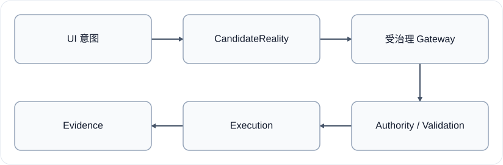
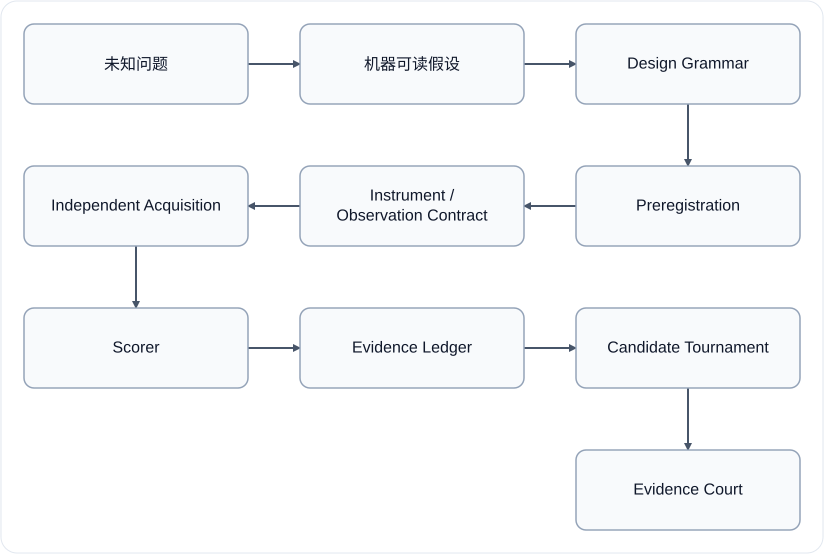

<div align="center">

# RCL — Reality Compiler Language

**研究预览 · K400 370/400（92.50%）· INCOMPLETE · U3**

**把权限、状态变化和执行证据写进程序的编程语言。**

[English](README.md) · [简体中文](README.zh-CN.md) · [5 分钟上手](GETTING_STARTED.zh-CN.md) · [网站 / Playground](https://rcl-rncs-mcp.vercel.app) · [当前状态](CURRENT-STATUS.md)

[](LICENSE)
[](package.json)
[](CURRENT-STATUS.md)
[](CURRENT-STATUS.md)

</div>

RCL（Reality Compiler Language）是一门开源编程语言，面向需要明确约束状态变化的程序：**谁可以行动、允许改变什么、哪些条件必须成立，以及如何记录执行结果的证据**。

本仓库包含语言实现、用 RCL 编写的 Native-Core 编译器、原生字节码虚拟机、Web / Android 后端与验证工具链。正式源码：`xingxuling/RCL@main`。

**RCL 当前是研究预览：K400 登记 370/400 PASS、30 UNTESTED，整体为 INCOMPLETE。** 此前升到“2.0 发布”的判断超过了整门语言的成熟度证据。`2.0.0` 仅保留为现有包、原生工件与历史验收记录的编号，冻结继续升版。已验证的会话和编译器能力属于有界实现成果。见[成熟度政策](docs/governance/RCL_RESEARCH_MATURITY_POLICY.md)与[K400 通关契约](docs/K400_COMPLETION_CAMPAIGN_v0.1.md)。

[RCL 原生程序](docs/K400_NEW_FAMILIES_2026-10-13.md)实现了表达式词元编译、RGB 变换与游程编码往返，以及固定步长的平台游戏规则。三者均通过十二种实际执行环境、冻结输入和原样独立修复验收；各自仍是有界能力，剩余 30 格继续开放。

[浏览器原生批次](docs/K400_BROWSER_NATIVE_2026-10-13.md)现已在真实 Chromium 窗口中编译和执行 RCL，并检查编译字节一致性、原生错误与页面重置，新增十四个不同格子，达到 216 格。当前目标继续是完整通关 400 格。

[GPU 原生批次](docs/K400_GPU_NATIVE_2026-10-13.md)新增十五格，达到 231 格。通用 RBC 解释器在真实 AMD FP64 OpenCL 设备上执行递归、序列操作、权限和事务；编译及返回快照的哈希由宿主负责。冻结输入、独立修复和进程重启检查均通过。

[RNCS 候选运行环境批次](docs/K400_RNCS_CANDIDATE_2026-10-13.md)再新增十五格，达到 246 格。复用正典 RNCS 分支执行器，实际调用 RCL、核对源码声明的权限、合并本地候选，并拒绝未批准或过期的合并。二进制浮点传输保持数值语义；这些仍是本地候选环境的有界执行证据。

[复制计数器批次](docs/K400_REPLICATED_COUNTER_2026-10-13.md)新增十五个分布式程序格子，达到 261 格。RCL 拥有复制状态合并与消息准入语义；十五种执行环境中的 45 个真实 HTTP 节点通过分区恢复、过期与重复消息、拒绝请求测试，以及冻结输入和独立修复验收。

[软实时批次](docs/K400_SOFT_REALTIME_2026-10-13.md)新增十六个不同格子，达到 277 格。十三类冻结程序使用实际单调计时器和异步原生进程，由 RCL 决定截止时间内的结果发布与失败处理。真实超时终止、取消退出、并发限流、暂停恢复和后续执行均通过验收；本地证据不包含硬实时保证。

[原生游戏批次](docs/K400_NATIVE_GAME_2026-10-13.md)新增十五个不同格子，达到 292 格；K188 增加新 profile，但不重复计数。通用 RCL 程序在每个固定步长实际执行，原生 RCL 场景控制器负责输入、位移、重力、碰撞和权限。十三类程序均通过完整场景重放与真实进程重置；分布式程序还通过已有三节点 HTTP 消息验收。

[科学计算工作台批次](docs/K400_SCIENTIFIC_2026-10-13.md)新增十六个不同格子，达到 308 格。RCL 原生数值核负责稳定矩统计、回归和误差门控发布，实际 NumPy/SciPy 独立复核相同的精确 binary64 样本。十四类程序通过冻结输入、原样修复、错误数值核拒绝、控制器恢复和真实观察进程退出；新增统计程序提供额外证据，不重复增加格子。

[原生建议型 AI 批次](docs/K400_ADVISORY_AI_2026-10-13.md)新增十五个不同格子，达到 323 格。实际 RCL 原生 MLP 训练与前向计算组成可调用的固定模型流程。十四类程序通过输入与模型根绑定、独立数值重放、模型替换和预测器权限拒绝、失败处理与真实控制器重置；K233 和重复算法坐标增加额外证据，不重复计数。

[原生 UI 事件批次](docs/K400_NATIVE_UI_2026-10-13.md)新增三十四个不同的 GUI/Web 格子，达到 357 格。RCL 负责按钮事件、状态修改、派生文字和渲染投影；十九种选定后端通过真实浏览器点击、鉴权与过期状态拒绝、重载和手机尺寸布局检查。380 轮基础流程、190 组冻结输入和 57 次原样独立修复全部通过；四个已有格子增加额外证据。当前整数计数器 profile 不代表原生系统控件、mobile 程序族或任意 UI 语义已完成。

[编译器流程批次](docs/K400_COMPILER_PIPELINE_2026-10-13.md)闭合 K328/K330/K335，达到 360 格。实际 RCL 编译与原生执行保留独立进程、指令和字节指标。现有游戏、媒体和 CRDT 程序通过 60 轮运行、30 组冻结输入、9 次独立修复和 10 组不同写法的额外复核；三节点 HTTP 消息绑定实际编译与执行账本。

[Android 原生继续开发](docs/K400_NATIVE_MOBILE_2026-10-14.md)已经加入真实原生控件、触控和生命周期恢复，由 RCL 后端拥有状态语义。新的 HTTP/副本/冷启动处理器适配器修复就绪发布，异步 ADB 传输使 RCL 桥接保持响应；一次嵌入式触控对照的五个状态根全部一致。旧记录保留归档，十九个后端按原性能门槛重新采集，完整索引通过前暂不增加 K400 格数。仓库提供冻结 APK 和可交互的演示入口。

[持久序列拼接候选运行时](docs/NATIVE_SEQUENCE_RUNTIME_2026-10-14.md)通过完整编译器连续二十代自举，字节完全一致，本机中位耗时约 3.9 秒。同源单次对照中，原运行时约 159.1 秒、候选约 6.4 秒，观察到约 24.7 倍提速。该运行时单独构建，版本号与 K400 通关数保持不变。

[原生核心自举批次](docs/K400_SELFHOST_COLUMNS_2026-10-14.md)闭合 K059/K039/K019/K079，达到 364 格。独立 RCL 编译器变体修复非 BMP 字符的源码列数，Windows/Linux/WASI/Chromium 共八十代自编译字节一致；四十个冻结程序和十二次原样独立修复重放通过。原始 Unicode 失败契约保留记录并保持零计数。

[GPU 文本与 UI 继续开发](docs/K400_GPU_TEXT_2026-10-14.md)闭合 K163/K164/K165，达到 367 个不同格子。GPU 直接执行 UTF-8 文本操作和数值转文本，驱动真实 Chromium 点击与 Android 原生触控；独立科学计数法编译、原生数值复核、冻结输入、原样独立修复和篡改拒绝通过。Android ATD 截图仍为黑屏，视觉像素验收保持待验证；已核验原生控件文本、触控与生命周期语义。剩余 30 格继续保持未通关。

[完整编译器运行时继续开发](docs/K400_SELFHOST_RUNTIME_2026-10-14.md)独立验证了 Android K099、HTTP 服务端 K119 和嵌入式 K299：各自均保持二十代完整自编译、十个封存原生程序和三份原样独立修复。公开的常驻编译器 API 复用原生 C ABI 实例，独立鉴权 HTTP API 接收实际编译器代次并执行原生程序；40 项针对性检查通过。全部证据经总汇总器复核，达到 370/400 PASS，30 格仍未通关。

## 为什么使用 RCL？

- **把权限和行为写在一起。** 主体、授权凭证、前置条件、状态修改与不变量都是语言构造。状态变化直接声明自身的权限和验证要求，不必只靠外围应用代码隐式约定。
- **让执行结果可检查。** 状态变化产生 witness 与 evidence；工具链用工件根和语义状态根核对不同实现的结果。证据始终绑定实际验证过的范围。
- **跨执行目标保留语义。** RCL 拥有状态与权限模型，原生字节码、Web 和 Android 路径提供不同的执行环境。候选 Native UI 模型在 Web / Android 后端之间共享 IR 与语义根。
- **用编译器验证编译器。** Native-Core 编译器用 RCL 编写，已有字节完全一致的 `C0 == C1 == C2` 固定点记录。这是编译器自举，不代表整套运行时已经完全自举。

RCL 适合探索带权限约束的应用状态、可审计自动化与语言 / 运行时研究。现有实现将受治理核心扩展为可持续调用的原生程序与本地持久会话；各项能力保留有界证据，整门语言的发展按 K400 验收。

[已验证能力](#v20) · [快速开始](#快速开始) · [持久会话](#4-运行持久会话) · [示例](#程序员建议按这些示例看) · [验证范围](#当前已经验证到什么程度) · [架构](#架构)

---

<a id="v20"></a>

## 历史实现里程碑（原 2.0 编号）

原编号 2.0.0 的实现让同一段 RCL 程序能够接收多次输入，并在进程重启后继续运行：

- **原生持续会话：** 初始化一次，按名字调用源码中的规则，保留已提交状态。参考实现与原生 VM 使用同一套受治理事务契约。
- **源码声明输入：** `input` facet 接收有类型的 Number、Truth、Text 观测；其它状态变化由规则所有。每次调用都根据当前状态重新检查条件授权。
- **原子候选状态：** guard、授权和 preserve 共同决定是否提交。拒绝、未触发规则和 `foresee` 预测都保留原已提交状态与输入。
- **本地持久重放：** 日志绑定源码、字节码、命令和精确状态根；新原生进程重放并核对已提交记录。请求 ID 防止重试重复，预期修订号拒绝过期更新。
- **RCL 编写的会话编译器：** 原生会话编译器由 RCL 编写，目标字节码与 bootstrap 编译器逐字节核对。会话使用 RBC 1.3；状态根 v2 与既有 typed-reference ABI 保持独立版本。

原始 2.0 验收的有界计数示例中，v1.0 守护进程默认 `RUN` 连续调用 50 次，每次结果仍为 **1**；v2.0 会话保留状态并累计到 **50**。当时源码快照的热调用 p95 约 **3 毫秒**，包含进程通信与独立状态根验证，不包含持久日志写入，也不代表后续维护的重新测速。见[验证记录](docs/v2.0/verification.json)和[会话验收](docs/v2.0/acceptance.md)。

持久会话范围为本地协作写入者与纯 RCL 规则，日志上限为 64 MiB / 10,000 条已接受命令。Provider 外部效果、分布式恰好一次执行和硬件断电恢复不在该范围内。输入、调用者认证责任与恢复契约见[会话文档](docs/v2.0/session-contract.md)。

**2026-10-12 维护，版本仍为 2.0.0：** 异常原生证据会关闭会话及其持久写入者；排队请求固定为调用时的内容；命令行支持可信历史校验并拒绝无效参数；同字段重复修改的原生与参考会话回执保持一致。[维护记录](docs/maintenance/session-integrity-2026-10-12.md)绑定本轮源码与 **61 项通过的相关检查**，其中 37 项为会话检查。未运行 GitHub Actions。

**编译器检查继续完善：** RCL 编写的编译器现已在生成字节码前检查条件授权中的未知引用、运算类型、调用参数及相关函数返回类型。[编译器维护记录](docs/maintenance/warrant-compiler-admission-2026-10-12.md)绑定 **89 项通过的相关检查**、120 个可支持示例的字节码一致性及重新验证的原生 `C0 == C1 == C2` 固定点。版本仍为 2.0.0；此前维护记录继续绑定各自的源码快照。

### 从 1.0 保留的稳定核心

原生 VM 与 `rcl run` 默认使用 `rcl.semantic-state-root.v2`，以精确有限 binary64 编码绑定最终状态与转移前后根。历史原生 v1 凭据仍可显式选择算法验证。`runReality` Reference API 保留其独立的 `rcl.reference-state-root.v0.6` 默认；使用 `stateRootAlgorithm` 可选择跨运行时 v2。参见[稳定契约](docs/v1.0/language-contract.md)、[状态根协议](docs/v1.0/semantic-state-root-v2.md)与[发布验收](docs/v1.0/acceptance.md)。

## 可移植原生执行

[原生核心程序族批次](docs/K400_GENOME_CAMPAIGN_2026-10-13.md)还验证了四个目标中的有界学习、代理推演、工作流、逻辑事件、治理/响应式和混合范式程序，各自包含十组预先封存的输入和三组独立修复重放。API `createPortableHttpTarget` 提供真实的本地 HTTP 编译/执行与访问令牌校验；[已完成的执行环境批次](docs/K400_EXECUTION_CONTEXTS_2026-10-13.md)还验证了持续嵌入式实例和双进程恢复。

同一套 C 虚拟机现在能作为 Windows 程序、wasm32-WASI 模块、Linux 程序和 x86_64 Android 模拟器中的原生程序运行。Linux/Android 在目标环境中执行 RCL 编写的编译器；WASI 使用 Windows 主机中的 RCL 编译器。目前已验证算法/命令行、内存关系查询与事务、离散模拟/科学计算，目标之间的字节码和语义状态根一致。

```sh
rcl portable-run wasm-vm examples/universal-stress/expansion-wave1/algorithm.rcl
rcl portable-run linux examples/universal-stress/portable-profiles/relations.rcl
rcl portable-run android examples/universal-stress/portable-profiles/simulation-scientific.rcl
```

API 导出 `createPortableNativeTarget(target)`，提供编译、执行和清理方法。运行工件在 `native/wasi/` 和 `native/linux/`。Windows 上的 Linux 执行需要配置 WSL，Android 需要连接 x86_64 模拟器，见[环境配置与凭据](docs/K400_EXPANSION_CAMPAIGN_2026-10-13.md)。这些仍是原生核心的有界能力，尚不能推导浏览器、物理设备、移动 UI 或整门语言可移植性。

## 快速开始

依赖：Git、Node.js 20+ 与 npm。先从源码运行 JavaScript / Reference Runtime：

### 1. 克隆并安装

```bash
git clone https://github.com/xingxuling/RCL.git
cd RCL
npm install
node src/reality-hub-cli.mjs --version
```

版本命令输出 `2.0.0`。以下源码示例直接调用公共 CLI 入口，无需预先全局安装 `rcl`。

### 2. 运行一个完整程序

```bash
npm run demo
```

这个命令运行 [`examples/hello-reality.rcl`](examples/hello-reality.rcl)：

```rcl
reality FirstLight {
  facet world.greeting : Text = "unformed"

  subject founder {
    facet awareness : Number = 0
    warrant world.write on world
  }

  emergence hello {
    cause founder
    when world.greeting == "unformed"
    needs world.write on world
    alter world.greeting <- "Hello, reality."
    alter founder.awareness <- founder.awareness + 1
    preserve founder.awareness >= 0
    witness "rcl:first-light"
  }

  foresee hello
  realize hello
}
```

先把它理解成：

```text
初始状态
+ 谁在操作
+ 他有什么权限
+ 什么条件下能操作
+ 候选状态怎么改变
+ 哪些条件必须始终保持
+ 用什么 witness / evidence 记录
+ commit
```

重点不是那句 Hello，而是：**谁能改什么、什么时候能改、改完必须保证什么，都写进程序里。**

### 3. 构建并运行 Native Path

Unix 类系统的原生构建需要 `make`、C11 编译器与 OpenSSL / libcrypto 开发文件，见 [`native/Makefile`](native/Makefile)。Windows 使用独立的 [`build-native-windows.mjs`](scripts/build-native-windows.mjs) 工具链路径。原生构建依赖与上面的参考运行时快速开始是分开的。

```bash
npm run build:native
npm run demo:native
```

再看 Bytecode → Native Execution：

```bash
npm run demo:bytecode
```

### 4. 运行持久会话

```bash
npm run demo:session
```

[持久计数示例](examples/sessions/persistent-counter-demo.mjs)会提交输入、预测变化、重启原生进程、重试原请求、撤销授权，并验证原生与参考重放。默认每次运行使用独立的状态目录。

从源码目录逐步查看命令时，请使用一个新的 `counter-state` 目录：

```bash
node src/reality-hub-cli.mjs session init examples/sessions/governed-counter.rcl ./counter-state
node src/reality-hub-cli.mjs session invoke ./counter-state examples/sessions/increment-command.json
node src/reality-hub-cli.mjs session invoke ./counter-state examples/sessions/increment-command.json
node src/reality-hub-cli.mjs session inspect ./counter-state
node src/reality-hub-cli.mjs session verify ./counter-state --reference
```

首次调用计数为 `3`；相同请求的重试返回 `replayed: true`，日志修订号仍为 `1`。发出新命令时，使用新的 `requestId` 和当前的 `expectedRevision`，见[命令示例](examples/sessions/increment-command.json)。

会话命令需要原生守护进程与编译器。已验证的 Windows 源码包含绑定源码字节的预构建工具；改动原生源码后可用 `npm run build:native` 重建。Unix 构建使用前文的依赖；2.0 的新 Linux 运行验证尚未执行。

### 5. 继续学习

Web 状态、Native UI、Android、Bytecode、自举编译器验证都放在：

**→ [`GETTING_STARTED.zh-CN.md`](GETTING_STARTED.zh-CN.md)**

英文版：

**→ [`GETTING_STARTED.md`](GETTING_STARTED.md)**

---

## 当前已经验证到什么程度？

冻结的[原始 2.0 验证记录](docs/v2.0/verification.json)绑定当时源码与工件：**332 个测试文件已覆盖，1702 项通过、0 项剩余失败、2 项明确跳过**，其中包括 19 项会话检查。Stage0–40 通过，120 个可支持示例逐字节一致，40 个示例明确保留不支持状态。当时的原生编译器在 277,414 字节上复现 `C0 == C1 == C2`。安装包也已在源码目录之外实际安装，执行公共 API、CLI、原生 RCL 编译和持久恢复重试。后续维护使用单独的[会话证据](docs/maintenance/session-integrity-2026-10-12.json)与[编译器证据](docs/maintenance/warrant-compiler-admission-2026-10-12.json)。

这是 **2.0 的 Windows 本地证据**。新 Linux、Android 设备与远端部署验收分别记录；未运行 GitHub Actions。[1.0 的历史记录](docs/v1.0/verification.json)包含 Windows/Linux 检查，属于本次 2.0 主线集成之前 [PR #262](https://github.com/xingxuling/RCL/pull/262) 的基线，未改称为 2.0 证据。各项能力和成熟度边界见 [`CURRENT-STATUS.md`](CURRENT-STATUS.md)。

| 能力 | 当前状态 |
|---|---|
| RCL 编写的通用编译器 | **已验证** |
| Native-Core 编译器固定点 `C0 == C1 == C2` | **已验证** |
| Native VM / Compiler Path | **存在并已测试** |
| 原生 / 参考持续会话与有类型输入 | **Windows 本地验证；当前 37 项会话检查通过** |
| 条件授权、拒绝与预测原子性 | **原生 / 参考差分检查通过** |
| 持久恢复、重试去重与写入者隔离 | **真实进程终止、OS 锁与日志控制检查通过** |
| 2.0 独立安装与公共 API / CLI | **Windows 本地验证通过** |
| 整门语言 Runtime 全自举 | **不宣称** |
| 完整 Web 垂直切片 | **有界 K02 profile 已通过 9/9 个 Gate** |
| Android 工程 / APK 构建路径 | **已验证** |
| Android 安装与交互 | **有界 K03 API 35 模拟器 profile 已通过；不宣称物理真机验证** |
| Web / Android 共用 Native UI semantic root | **当前候选切片已验证** |
| Native UI Navigation + 宽度自适应 | **候选状态，自举切片已验证** |
| Universal Program Stress | **持续运行，大部分 400 格仍保持 UNKNOWN** |

### 自举编译器

```text
RCL 编译器源码
      ↓
     C0
      ↓
用编译器编译自己
      ↓
     C1
      ↓
再次编译
      ↓
     C2

C0 == C1 == C2
```

必须区分：

- **Native-Core Self-Hosting：已验证**
- **Whole-Language Runtime Self-Hosting：未宣称**

---

## 程序员建议按这些示例看

| 示例 | 主要展示 | 源文件 |
|---|---|---|
| First Light | 最小状态 + 权威 + 状态变化 | [`examples/hello-reality.rcl`](examples/hello-reality.rcl) |
| 持久计数会话 | 有类型输入、条件授权、原生进程恢复与重试 | [`examples/sessions/persistent-counter-demo.mjs`](examples/sessions/persistent-counter-demo.mjs) |
| 受治理 Web 状态 | guard、mutation、invariant、evidence | [`examples/universal-stress/k02-complete-web-app.rcl`](examples/universal-stress/k02-complete-web-app.rcl) |
| Native UI 计数器 | state、derived、binding、layout、style、event | [`examples/native-ui/counter.rcl`](examples/native-ui/counter.rcl) |
| 应用内导航 | route 与原子化 UI-local navigation | [`examples/native-ui/navigation.rcl`](examples/native-ui/navigation.rcl) |
| 设备自适应 | width profile 与跨平台自适应布局意图 | [`examples/native-ui/device-adaptation.rcl`](examples/native-ui/device-adaptation.rcl) |
| Android 垂直切片 | 受治理应用状态如何 Lower 到 Android | [`examples/universal-stress/k03-native-android-app.rcl`](examples/universal-stress/k03-native-android-app.rcl) |

### Native UI 示例

```rcl
reality NativeUICounter {
  ui CounterApp {
    state count : Number = 0
    derived count_label : Text = "计数：" + count

    view Root {
      layout vertical {
        width fill
        height intrinsic
        gap 12
        padding 24
        align stretch
        distribute start
      }

      text CounterText {
        bind value <- count_label
      }

      action IncrementButton {
        label "增加"
        on activate {
          set count <- count + 1
        }
      }
    }
  }
}
```

完整文件还有 lifecycle、theme、style、accessibility label 和 reset 行为。

### Navigation 示例

```rcl
navigation {
  initial home
  route home -> HomeScreen
  route settings -> SettingsScreen
}

on activate {
  set visits <- visits + 1
  navigate settings
}
```

### Device Adaptation 示例

```rcl
adaptation {
  default compact
  profile compact min_width 0 max_width 599
  profile expanded min_width 600
}

view Root {
  layout vertical {
    width fill
    height intrinsic
  }

  adapt expanded layout horizontal
}
```

当前候选实现会把同一份语义 Lower 成 Web width-profile 行为，以及 Android 基于 `screenWidthDp` 的布局选择。

推荐阅读顺序：

```text
hello-reality.rcl
→ K02 Web 状态变化
→ Native UI Counter
→ Navigation
→ Device Adaptation
→ K03 Android 垂直切片
→ selfhost/compiler-core.rcl
→ CURRENT-STATUS.md
```

更多可运行示例与 Evidence Fixtures 都在 [`examples/`](examples/) 目录。

---

## Native UI Genome

RCL 正在把 UI 作为语言语义的一部分，而不是把 Web 和 Android 当成两个毫无关系的前端。

当前候选语义包括：

- state / derived expressions；
- lifecycle / restore；
- theme / style rules；
- recursive view tree；
- bindings；
- typed / inferred event parameters；
- governed `reality-transaction`；
- fixed sizing；
- in-app navigation；
- available-width adaptation profiles。


[可编辑图表源码](docs/readme-diagrams/native-ui-genome.mmd)。

真实 Chrome 已验证当前 width-profile adaptation；Android Backend 也已经从同一 semantic root 生成并构建真实 Debug APK。

有界 K03 transaction UI 已记录 API 35 模拟器安装、交互、旋转恢复与性能证据。**这不等于物理真机验证，也不覆盖全部 Native UI 候选功能。** 具体边界见 [`CURRENT-STATUS.md`](CURRENT-STATUS.md)。

---

## UI 与现实治理

RCL 明确区分本地 UI 状态变化：

```text
UI-local event
→ local candidate state
→ local validation
→ local commit
```

和现实动作：



[可编辑图表源码](docs/readme-diagrams/governed-ui-zh.mmd)。

UI 本身不能直接提交外部现实变化。未知规则、混合 authority handler 等情况在已验证切片中会 fail closed。

---

## Universal Program Stress

RCL 当前长期验证主线是一张固定的：

```text
20 个环境族 × 20 个程序族 = 400 个长期验证格
```

每个证据格需要独立通过 9 个非补偿式 Gate：

1. `EXPRESS`
2. `COMPILE`
3. `LOWER`
4. `EXECUTE`
5. `CORRECT`
6. `ROBUST`
7. `PERFORMANCE`
8. `AI_GENERATE`
9. `EVIDENCE`

缺一个必要 Gate 就是 BLOCKED；必要 Gate 失败就是 FAIL，不能靠其它高分抵消。

当前记录为 `370 PASS / 0 BLOCKED / 30 UNTESTED`，成熟度 `U3`，K400 仍为 `INCOMPLETE`。PASS 仅针对冻结的有界证据 profile，不代表整个程序族或环境族均已解决。[可移植通关批次](docs/K400_EXPANSION_CAMPAIGN_2026-10-13.md)新增了 Windows/WASI/Linux/Android 模拟器执行证据。[执行环境批次](docs/K400_EXECUTION_CONTEXTS_2026-10-13.md)验证了鉴权 HTTP、持续嵌入式实例和双节点恢复，新增 35 个不同格子。[原生任务批次](docs/K400_JOB_CONTEXTS_2026-10-13.md)通过冷请求进程、SQLite 事务和工作线程数据流再新增 36 格。[原生 RCL 阶段批次](docs/K400_NATIVE_PHASES_2026-10-13.md)通过绑定源码的时钟和任务控制器新增 24 格；[表达式、媒体与游戏批次](docs/K400_NEW_FAMILIES_2026-10-13.md)将三个新 RCL 程序放入十二种实际执行环境，新增 36 格，达到 202 格，完成“至少 200 格”的开发里程碑。K233 的有界两层 Dense General MLP profile 已闭合；后续 Tensor / Autodiff 候选保留独立证据边界，见 [`CURRENT-STATUS.md`](CURRENT-STATUS.md)。

### 当前 Killer Tasks

| Task | 目标 | 模式 | 当前结果 |
|---|---|---|---|
| **K01** | 自举编译器 | native semantic | `PASS (9/9)，有界 profile` |
| **K02** | 完整 Web 应用 | lowered execution | `PASS (9/9)，有界 profile` |
| **K03** | Native Android 应用 | lowered execution | `PASS (9/9)，有界模拟器 profile` |
| **K04** | 2D Game | lowered execution | `PASS (9/9)，有界确定性 Runtime` |

---

## 三种能力模式

### `native-semantic`

RCL 自己拥有相关计算语义。

### `lowered-execution`

RCL 拥有语义，但有意把执行 Lower 到浏览器、Android、SQL、GPU 或其它 Backend Organ。

### `opaque-delegation`

RCL 把真正困难的问题整体交给外部工具或其它语言，然后只接收结果。

Opaque delegation 可以很有用，但**不能冒充 RCL 原生能力**。

---

## Frontier：把未知问题编译成实验



[可编辑图表源码](docs/readme-diagrams/frontier-experiments-zh.mmd)。

当前 Frontier 沙箱成功只能证明协议能否区分预构造世界，**不能推出新物理、外部未知信息通道或其它现实结论。**

---

## 架构


[可编辑图表源码](docs/readme-diagrams/architecture.mmd)。

2.0 会话路径复用图中的编译器与原生 VM：[RCL 会话编译器](selfhost/session-compiler-core.rcl) → RBC 1.3 → [原生会话适配器](src/native-session.mjs) → [持久日志与重放](src/durable-session.mjs)。输入、事务和恢复边界见[会话契约](docs/v2.0/session-contract.md)。

---

## 常用命令

```bash
npm install
npm run demo
npm run build:native
npm run demo:native
npm run demo:bytecode
npm run demo:session
npm run test:sessions
npm run verify:v2-release
npm run build:selfhost-compiler
npm run verify:selfhost-fixedpoint
npm run verify:selfhost-examples
```

逐步解释见 [`GETTING_STARTED.zh-CN.md`](GETTING_STARTED.zh-CN.md)。

---

## 项目目录

```text
src/                         语言 / Runtime / Reference Implementation
selfhost/                    RCL 编写的编译器源码与 fixed-point artifact
selfhost/session-compiler-*  RCL 编写的会话字节码编译器
src/native-session.mjs       命名规则调用与有类型观测
src/durable-session.mjs      源码绑定日志、OS 写入锁与重放
native/                      Native VM / Compiler / Provider Boundary
examples/                    可运行示例与 Evidence Fixtures
examples/sessions/           持久计数与命令示例
tests/                       Conformance / Regression / Stress Tests
scripts/                     Build / Verification / Stress Runner
docs/                        架构、Campaign、Evidence、Governance
docs/v2.0/                   会话契约与本地发布验证
CURRENT-STATUS.md            当前人类可读权威状态
VERSION-CONTRACT.json        机器可读 Capability Contract
COMPONENT-VERSIONS.json      受治理 Component Identity
```

---

## 欢迎贡献

适合外部贡献的方向包括：

- 当前语义的最小可复现失败案例；
- Universal Program Stress 暴露出的 missing primitive；
- 保持 RCL-owned semantics 的 Backend Lowering；
- Reference / Self-host / Native 路径差分测试；
- Self-host Compiler / VM 性能优化；
- Native UI resources、accessibility、真机验证；
- 超出 K01 / K02 冻结 profile 的独立 AI generation / repair evaluation。

**更强的 claim 必须来自更强的 evidence，而不是更强的措辞。**

---

## 当前不宣称

本仓库当前**不宣称**：

- RCL 已经能写所有程序；
- Whole-Language Runtime 已完全自举；
- 所有 Foundation Domain 都是 Native；
- Android 真机执行已经完成正式验证；
- 生成 Artifact 等于真实运行成功；
- Frontier 沙箱实验已经证明新的自然规律或现实外部效应。

项目的意义恰恰是：把这些边界变成显式、可测试、可反证的工程对象。

---

## License

Apache-2.0。详见 [`LICENSE`](LICENSE)。
