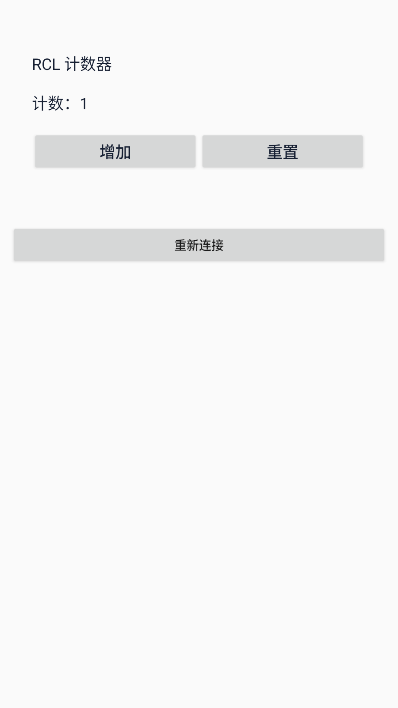

# Native Android mobile continuation

**Status: PARTIAL_ACQUISITION. K400 remains 360 PASS / 40 UNTESTED, U3, INCOMPLETE.**

The Android frontend now uses actual native `TextView` and `Button` instances.
RCL owns each event mutation, derived label and render projection through the
selected backend. The Java client transports snapshots and renders them; it
does not implement the counter arithmetic. The existing UI IR, Android emitter,
event lowering and target adapters are reused.

The frozen integer counter has an initial value, a configurable step, increment
and reset. The API35 x86_64 Android emulator receives real touch events. The
Windows and WASI backends have each passed 20 complete four-touch flows, ten sealed input flows,
three effective semantic mutations and three unchanged independent repairs.
Rotation recreates the activity in the same process; force-stop/relaunch creates
a new process. Both recover the same state from the still-running RCL backend.
Invalid credentials, stale state, unknown events and denied RCL authority leave
the committed state unchanged. Installed APK bytes, native hierarchy, accessible
labels, button bounds, process IDs and screenshot bytes are bound to the receipt.



The frozen campaign requires all nineteen selected backends. Seventeen remain;
acquisition is
still in progress, so its profile index is not admitted and no mobile coordinate
is added yet. When every frozen environment passes, eighteen currently open
coordinates may gain credit; the existing Android coordinate receives an
additional profile. GPU remains outside this contract because its current RBC
interpreter lacks the required Text operations.

The independent contexts received only frozen mutated candidates and task
requirements. Canonical source, oracle edits and sealed inputs were withheld.
They returned exact proposals; the evaluator applied and checked them unchanged.
This uses separate model contexts and makes no operating-system isolation claim.

## Run the native application

With the configured Android emulator and ADB available, after the acquisition
has finished:

```text
npm run demo:native-mobile
```

The command installs the frozen client, starts the local Windows RCL backend and
opens the application. The increment and reset controls can be operated directly.
Ctrl+C closes the owned bridge and removes its ADB reverse mapping. An optional
environment argument selects another supported backend.

```text
npm run demo:native-mobile -- browser
npm run build:native-mobile-bridge
npm run test:native-mobile
npm run run:k400-mobile
npm run verify:k400-mobile
```

The rebuild uses the local offline Gradle/Android SDK setup. Changing the client
requires a new frozen contract and fresh runtime acquisition; existing receipts
cannot be silently rebound. Avoid launching the demo while the serial campaign
is operating the same package and emulator.

## Evidence

- [Frozen contract](../examples/universal-stress/mobile-native/native-counter-contract.json)
- [APK](../examples/universal-stress/mobile-native/native-counter-client.apk)
- [Build receipt](../examples/universal-stress/mobile-native/native-counter-build.json)
- [Windows runtime receipt](../examples/universal-stress/mobile-native/native-counter-windows-runtime.json)
- [WASI runtime receipt](../examples/universal-stress/mobile-native/native-counter-wasm-vm-runtime.json)
- [Independent proposals](../examples/universal-stress/mobile-native/native-counter-proposals.json)
- [Admission checks](../tests/k400-mobile-admission.test.mjs)

Contract root: `4cc02f1bc5e314ce3848ae7e085da52ef82ac1c212dd7aca268cf05c4a4b86dd`.
Windows report root: `ff7a4e058019b2e72573238fa12c01d6481b30b1c17c4d5f67d383be07993101`.
WASI report root: `8631dbbf4001b24708d980e823bcebbe9df18c832f1f47e61c40dc527ff3b939`.
APK SHA256: `b1b315afdb70e518de73d7597cc70fcb3b58687dffb9d5dbed4273131939135c`.

Twenty-one targeted bridge/admission checks pass, including forged APK, display,
touch, authority, hierarchy, screenshot and lifecycle rejection. Windows native
compile/execute P95 is approximately 166/209 ms; WASI is approximately 198/608 ms. Android startup, hierarchy and
touch overhead is retained separately from these native backend measurements.

This is a connected emulator counter with cooperative in-memory backend state.
It does not establish offline RCL execution inside the APK, backend crash
persistence, physical-device acceptance or completion of the whole mobile
platform. No hosted Actions run is requested; version advancement stays frozen.
